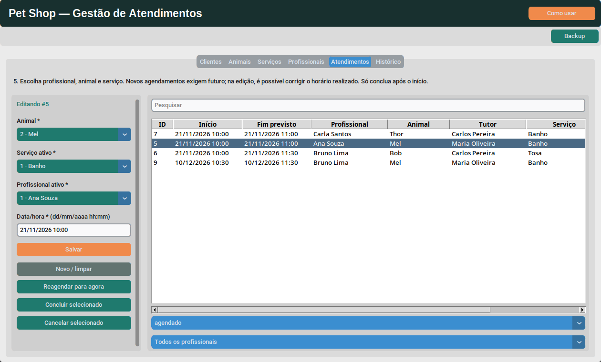
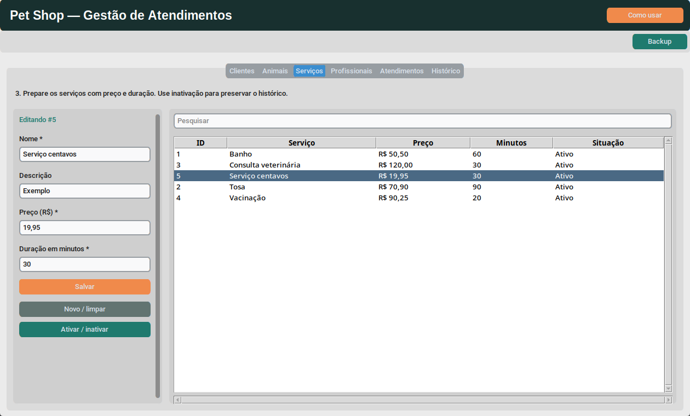
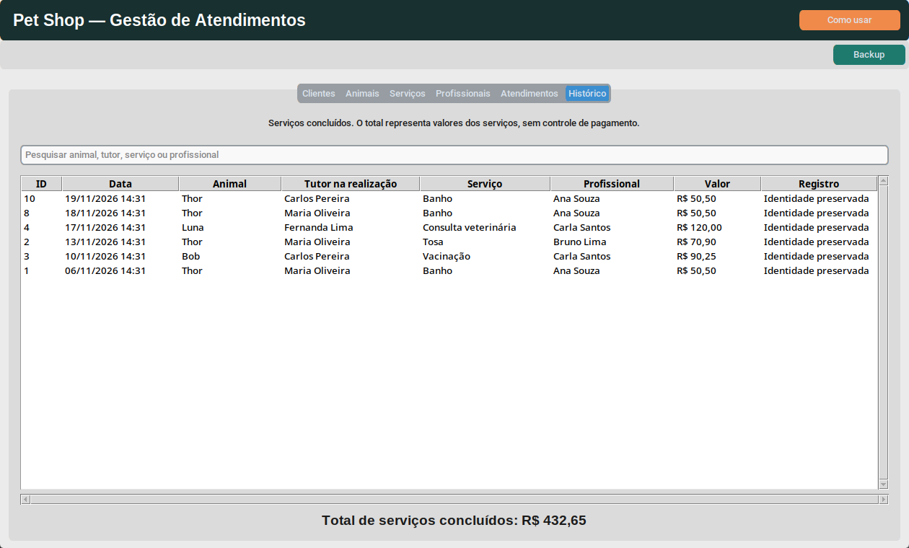

# Sistema para Pet Shop 🐾

Aplicativo desktop para gerenciar tutores, animais, serviços, profissionais e atendimentos de um pet shop, desenvolvido em **Python**, com interface **CustomTkinter** e banco local **SQLite**.

Projeto acadêmico de **Desenvolvimento Rápido de Aplicações em Python (RAD/DRAP)**, da **Universidade Estácio de Sá**, com código-fonte, testes, relatório, apresentação e evidências da Etapa 4. A revisão funcional documentada é de **20/11/2026**.



## Para avaliar o projeto

| Material | Acesso |
| --- | --- |
| Relatório acadêmico | [PDF](relatorio/Relatorio_PetShop_RAD.pdf) · [Word editável](relatorio/Relatorio_PetShop_RAD.docx) |
| Apresentação da Etapa 4 | [PDF](Etapa4_PetShop.pdf) · [PowerPoint editável](Etapa4_PetShop.pptx) |
| Requisitos e critérios de aceitação | [REQUISITOS_E_ACEITACAO.md](REQUISITOS_E_ACEITACAO.md) |
| Evolução por iterações | [EVOLUCAO_POR_ITERACOES.md](EVOLUCAO_POR_ITERACOES.md) |
| Análise dos fluxos e regras | [ANALISE_DO_FLUXO.md](ANALISE_DO_FLUXO.md) |
| Resultados técnicos e reprodução dos testes | [VALIDACAO_ETAPA4.md](VALIDACAO_ETAPA4.md) |
| Roteiro de validação com pessoa usuária | [VALIDACAO_DE_USO.md](VALIDACAO_DE_USO.md) |
| Capturas e registros de testes | [evidencias/README.md](evidencias/README.md) |
| Documentação técnica do aplicativo | [petshop/README.md](petshop/README.md) |

## Funcionalidades

- **Tutores:** cadastro, edição, busca e validação de CPF, telefone e e-mail. CPF e e-mail informado são únicos; alertas de dados semelhantes ajudam a revisar possíveis duplicidades.
- **Animais:** cadastro vinculado ao tutor, com espécie, raça e observações.
- **Serviços:** descrição, preço, duração e ativação/inativação. Valores são calculados e armazenados em centavos inteiros.
- **Profissionais:** cadastro, ativação/inativação e equipe fictícia para demonstração.
- **Agenda:** agendamento, edição, reagendamento, conclusão e cancelamento com motivo, com filtros por profissional e estado do atendimento.
- **Prevenção de conflitos:** verifica o intervalo completo de cada reserva para impedir sobreposição do mesmo animal ou profissional.
- **Histórico:** conserva os dados da realização, incluindo tutor e profissional, descrição contratada e valor; exibe o total de serviços concluídos.
- **Acesso:** criação do primeiro usuário, senha com hash PBKDF2-SHA256 e recuperação por código via Resend, quando configurada.
- **Backup:** cópia consistente do banco SQLite pelo próprio aplicativo.

## Tecnologias e organização

| Tecnologia | Uso |
| --- | --- |
| Python 3.10+ | Linguagem e regras de negócio |
| CustomTkinter e Tkinter/ttk | Interface gráfica desktop |
| SQLite (`sqlite3`) | Persistência local, transações e integridade dos vínculos |
| `unittest` | Testes automatizados e simulação do envio de e-mail |
| Resend, via HTTPS | Recuperação opcional de senha |

A interface fica em `app.py` e `login.py`; a persistência e as regras transacionais, em `database.py`. Validações, identidade de clientes, similaridade e recuperação de senha possuem módulos próprios. O aplicativo funciona localmente, sem servidor de banco de dados.

```text
petshop-mvp/
├── README.md
├── .gitignore
├── petshop/                     # Aplicativo desktop
│   ├── app.py                   # Ponto de entrada e interface principal
│   ├── login.py                 # Acesso, primeiro usuário e recuperação
│   ├── database.py              # Banco, regras, migrações e backup
│   ├── validacoes.py
│   ├── duplicidade_clientes.py
│   ├── similaridade_clientes.py
│   ├── recuperacao.py
│   ├── popular_demo.py          # Dados fictícios
│   ├── requirements.txt
│   ├── resend.ini.example       # Modelo sem credenciais
│   └── tests/
├── evidencias/                  # Capturas e resultados documentados
├── relatorio/                   # Relatório em PDF/DOCX e gerador
├── apresentacao/                # Gerador dos slides
├── Etapa4_PetShop.pdf
├── Etapa4_PetShop.pptx
└── *.md                         # Requisitos, evolução, análise e validação
```

## Como executar

### Pré-requisitos

- Python **3.10 ou superior**, com `pip`, `venv` e **Tkinter** disponíveis.
- Ambiente gráfico para abrir as janelas do aplicativo.
- Git para clonar o repositório, ou download pelo botão **Code → Download ZIP**.

Para conferir o Tkinter, execute `python -m tkinter` (ou `python3 -m tkinter` no Linux). Deve abrir uma janela de demonstração. Em distribuições Linux, pode ser necessário instalar os pacotes de Tkinter e `venv` correspondentes ao Python utilizado.

### Linux e macOS

```bash
git clone https://github.com/niZZude/petshop-mvp.git
cd petshop-mvp/petshop
python3 -m venv .venv
source .venv/bin/activate
python -m pip install -r requirements.txt
python app.py
```

### Windows (PowerShell)

```powershell
git clone https://github.com/niZZude/petshop-mvp.git
cd petshop-mvp/petshop
py -m venv .venv
.\.venv\Scripts\python.exe -m pip install -r requirements.txt
.\.venv\Scripts\python.exe app.py
```

Os comandos do Windows usam diretamente o Python do ambiente virtual, sem precisar ativá-lo.

### Primeiro acesso e demonstração

1. Abra o aplicativo e cadastre seu usuário, senha e e-mail de recuperação. **Não existe senha padrão.**
2. O banco `petshop/petshop.db` é criado automaticamente no primeiro uso.
3. Aceite a carga de dados fictícios oferecida pelo sistema para explorar os cadastros e atendimentos. Como alternativa, com o aplicativo fechado e o banco de cadastros vazio, execute `python popular_demo.py` na pasta `petshop/`.
4. Na aba **Profissionais**, o botão **Adicionar equipe fictícia** permite incluir profissionais de exemplo sem criar contas de acesso.
5. Para demonstrar a conclusão, selecione um atendimento agendado, use **Reagendar para agora**, confirme e conclua. O sistema impede concluir um atendimento cujo início ainda esteja no futuro.

O e-mail sugerido na tela de primeiro acesso deve ser revisado antes de salvar. Usuários de acesso, tutores e profissionais são cadastros distintos. A carga fictícia não cria usuários nem envia e-mails.

## Recuperação de senha (opcional)

O cadastro, login e gerenciamento do pet shop podem ser demonstrados sem configurar o provedor de e-mail. A configuração abaixo é necessária para o envio dos códigos de recuperação.

1. Copie `petshop/resend.ini.example` para `petshop/resend.ini`.
2. Preencha `api_key` no arquivo local e ajuste o remetente conforme sua conta Resend.
3. Também é possível usar as variáveis de ambiente `RESEND_API_KEY` e `RESEND_FROM`, que têm prioridade sobre o arquivo.

O modo de teste com `onboarding@resend.dev` exige que o destinatário seja o e-mail da própria conta Resend. O passo a passo e os limites estão no [README técnico](petshop/README.md#recuperação-de-senha-com-resend).

**Não publique chaves ou o arquivo preenchido.** O `.gitignore` exclui `resend.ini`, arquivos `.env`, bancos locais, backups, ambientes virtuais e caches; o modelo `resend.ini.example` permanece versionado.

## Testes e evidências

Na pasta `petshop/`, usando o Python do ambiente virtual:

```bash
python -W error::ResourceWarning -m unittest discover -s tests -v
```

A suíte contém **78 testes automatizados**, com bancos temporários e envio de e-mail simulado. Cobre validações, migrações, transações, concorrência, conflitos de agenda, centavos, histórico, login, recuperação e backup.

Os testes gráficos exigem as dependências do aplicativo e uma sessão gráfica:

```bash
python tests/smoke_interface.py
python tests/smoke_revisao.py
```

A revisão de 20/11/2026 registra **31 verificações gráficas de regressão e 28 da revisão**. Os registros estão em [evidencias/](evidencias/). Para gerar novas capturas, instale Pillow no ambiente de testes e execute `python tests/smoke_revisao.py --capturas ../evidencias`.

| Serviços com valores em centavos | Histórico com tutor da realização |
| --- | --- |
|  |  |

Os testes usam dados fictícios. O envio real de e-mail e a observação de uma pessoa usando o sistema não foram realizados na revisão documentada. O roteiro de observação está disponível em [VALIDACAO_DE_USO.md](VALIDACAO_DE_USO.md).

## Escopo e limitações

Este é um **MVP acadêmico desktop**, com banco local. Não inclui pagamentos, estoque, jornada de trabalho, férias, restrições de especialidade ou perfis de administrador e atendente. O total do histórico representa serviços concluídos, sem controle de recebimento.

O banco original de uma versão anterior não foi recuperado; uma instalação nova começa sem dados reais. A reconstrução e as mudanças posteriores estão descritas na [evolução por iterações](EVOLUCAO_POR_ITERACOES.md). Registros legados migrados mantêm os dados disponíveis e sua identificação de origem, sem inventar informações históricas.

## Relatório e apresentação

Os documentos prontos para avaliação estão incluídos no repositório. Para gerar novas versões editáveis, são necessárias dependências adicionais, separadas das dependências do aplicativo:

```bash
# Execute na raiz do repositório, com o ambiente virtual ativo.
python -m pip install python-docx matplotlib python-pptx
python relatorio/gerar_relatorio.py
python apresentacao/gerar_slides.py
```

Os scripts gravam os documentos nas pastas da entrega. A exportação dos arquivos editáveis para PDF é feita pelo Word, PowerPoint ou LibreOffice.

## Autores

- Eduardo Guther Pontes Leal — [@niZZude](https://github.com/niZZude)
- João Sérgio Cavalcante Marques Araújo

Universidade Estácio de Sá · Desenvolvimento Rápido de Aplicações em Python · Etapa 4.
